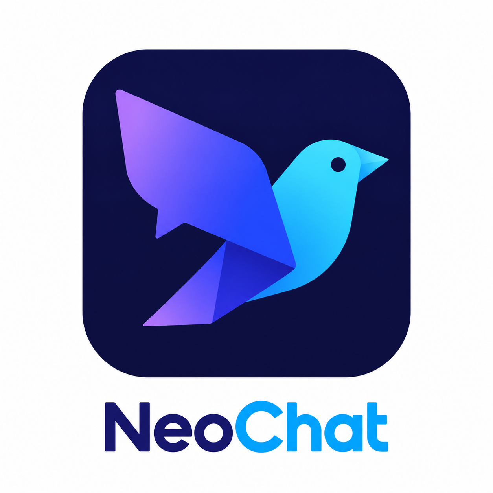

# NeoChat

[English](README.md) | [Português](README.pt-BR.md)




Client de bureau Windows écrit en Rust pour discuter avec les modèles de [Mistral](https://mistral.ai). Connectez-vous avec votre compte Mistral dans le navigateur ou renseignez une clé API. Il propose des réponses en streaming, le format Markdown et un historique local des conversations. L'interface utilise egui et eframe.

> **Projet indépendant :** NeoChat n'est pas affilié à Mistral AI et n'est pas un produit officiel de Mistral.

## Fonctionnalités

- Réponses en streaming avec possibilité d'arrêter, de copier ou de régénérer.
- Gestion des conversations dans la barre latérale : recherche par titre, création, renommage et suppression.
- Sélection du modèle dans la barre supérieure ou les paramètres, avec chargement des modèles disponibles via l'API.
- Réglage de la température, de la limite de tokens, du cache de contexte et du thème clair, sombre ou système.
- Connexion avec un compte Mistral ou une clé API, protégée par DPAPI sous Windows.
- Métriques de génération lorsqu'elles sont disponibles.

## Prérequis de compilation

- Windows 10 ou 11 en 64 bits avec un pilote graphique à jour.
- Rust stable avec la chaîne d'outils MSVC (testé avec Rust 1.99.1).
- Visual Studio Build Tools avec la charge de travail **Desktop development with C++**, le SDK Windows et `rc.exe`.

## Exécution

```powershell
cargo run --release
```

Ouvrez **Configurações** (paramètres) dans la barre latérale ou appuyez sur `Ctrl+,`. Dans l'onglet **Conta** (compte), cliquez sur **Entrar com a conta Mistral** et connectez-vous avec votre compte Mistral dans le navigateur. Vous pouvez aussi saisir une clé obtenue dans la [console Mistral](https://console.mistral.ai/api-keys). La connexion par navigateur obtient également une clé API utilisée par l'application pour les conversations. Cliquez sur **Salvar** pour enregistrer les paramètres modifiés. L'interface de l'application est en portugais.

Vous pouvez aussi fournir la clé par une variable d'environnement :

```powershell
$env:MISTRAL_API_KEY = "votre-cle-api"
cargo run --release
```

Les paramètres sont organisés en onglets : compte, modèle, génération, apparence et à propos. Le test de connexion se trouve dans l'onglet du compte.

## Création du paquet

```powershell
.\scripts\package.ps1
```

Le script compile la version release et crée `dist\NeoChat.exe`, une copie nommée `dist\NeoChat Mistral.exe`, les fichiers README et `dist\LICENSE`. Le dossier peut être copié sur un autre ordinateur Windows compatible, sans installer Rust ni les outils de compilation.

Lorsqu'une release est publiée sur GitHub, GitHub Actions compile et joint `NeoChat-windows-x86_64.exe` et `NeoChat-linux-x86_64`. Sous Linux, rendez le binaire exécutable avec `chmod +x NeoChat-linux-x86_64`. Le binaire Linux dépend des bibliothèques graphiques du système ; la clé API enregistrée sur le disque n'est pas chiffrée sous Linux.

## Raccourcis clavier

| Raccourci | Action |
| --- | --- |
| `Enter` | Envoyer le message |
| `Shift+Enter` | Insérer un saut de ligne |
| `Esc` | Arrêter la génération ou fermer la fenêtre |
| `Ctrl+N` | Nouvelle conversation |
| `Ctrl+,` | Ouvrir les paramètres |
| `Ctrl+B` | Afficher ou masquer la barre latérale |

## Données et confidentialité

L'application enregistre `config.json` à côté de l'exécutable, avec le prompt système modifiable. Si ce fichier n'existe pas, les anciens paramètres sont chargés depuis `%APPDATA%\NeoChat`. Le dossier de l'exécutable doit être accessible en écriture.

Les conversations et les identifiants sont stockés dans `%APPDATA%\NeoChat` :

| Fichier | Contenu |
| --- | --- |
| `conversations.json` | Conversations, messages et métriques |
| `secret.dat` | Clé API chiffrée avec DPAPI pour l'utilisateur Windows actuel |

Les messages sont transmis à l'API de Mistral. La connexion et le chargement des modèles communiquent également avec les services de Mistral.

## Structure et vérification

L'interface se trouve dans `src/app/`, le client API dans `src/mistral.rs`, la persistance dans `src/storage.rs` et `src/secrets.rs`.

```powershell
cargo test --all-targets
cargo clippy --all-targets -- -D warnings
```

## Développement

Développé par Giseldo Neo.

## Licence

Distribué sous la [licence MIT](LICENSE).
