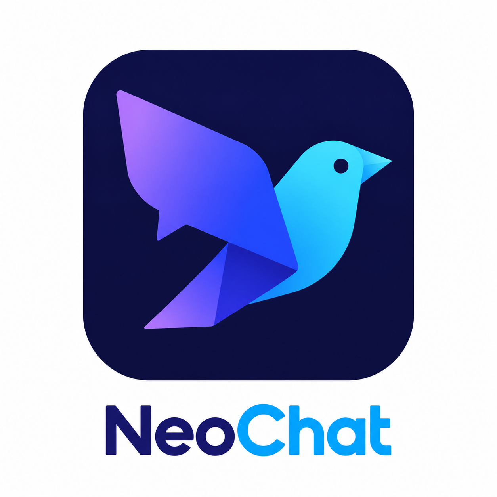

# NeoChat

[Português](README.pt-BR.md) | [Français](README.fr.md)




A Windows desktop client written in Rust for chatting with [Mistral](https://mistral.ai) models. Sign in with your Mistral account in your browser or provide an API key. It provides streaming responses, Markdown and local conversation history. The interface uses egui and eframe.

> **Independent project:** NeoChat has no affiliation or relationship with Mistral AI. It is not an official Mistral product.

## Features

- Streaming responses with stop, copy and regenerate actions.
- Sidebar conversation management, including title search, creation, renaming and deletion.
- Model selection in the top bar or settings, with an option to load models available from the API.
- Temperature, token limit, context caching and system, light or dark theme settings.
- Mistral account login or API key authentication, with the key protected by Windows DPAPI.
- Generation metrics when available.

## Build requirements

- 64-bit Windows 10 or 11 with an up-to-date graphics driver.
- Stable Rust with the MSVC toolchain (tested with Rust 1.99.1).
- Visual Studio Build Tools with the **Desktop development with C++** workload, including the Windows SDK and `rc.exe`.

## Run

```powershell
cargo run --release
```

Open **Configurações** (Settings) in the sidebar or press `Ctrl+,`. In the **Conta** (Account) tab, click **Entrar com a conta Mistral** and complete sign-in with your Mistral account in your browser. Alternatively, enter a key from the [Mistral console](https://console.mistral.ai/api-keys). Browser sign-in also obtains an API key for the application to use in conversations. Click **Salvar** (Save) to apply edited settings. The application interface is in Portuguese.

Alternatively, provide the key through an environment variable:

```powershell
$env:MISTRAL_API_KEY = "your-api-key"
cargo run --release
```

Settings are organized into Account, Model, Generation, Appearance and About tabs. The connection test is in the Account tab.

## Package

```powershell
.\scripts\package.ps1
```

The script builds the release and creates `dist\NeoChat.exe`, a copy named `dist\NeoChat Mistral.exe`, `dist\README.md`, and `dist\LICENSE`. The folder can be copied to another compatible Windows computer; Rust and build tools are not needed to run the package.

When a GitHub release is published, GitHub Actions builds and attaches `NeoChat-windows-x86_64.exe` and `NeoChat-linux-x86_64`. On Linux, make the binary executable with `chmod +x NeoChat-linux-x86_64`. The Linux binary requires system graphics libraries; API keys saved on disk are not encrypted on Linux.

## Keyboard shortcuts

| Shortcut | Action |
| --- | --- |
| `Enter` | Send message |
| `Shift+Enter` | Insert line break |
| `Esc` | Stop generation or close window |
| `Ctrl+N` | New conversation |
| `Ctrl+,` | Open settings |
| `Ctrl+B` | Show or hide the sidebar |

## Data and privacy

The application saves `config.json` next to the executable, including the editable system prompt. When no local config exists, previous settings are loaded from `%APPDATA%\NeoChat`. The executable directory must be writable.

Conversations and credentials are stored in `%APPDATA%\NeoChat`:

| File | Contents |
| --- | --- |
| `conversations.json` | Conversations, messages and metrics |
| `secret.dat` | API key encrypted with DPAPI for the current Windows user |

Messages you send are transmitted to the Mistral API. Login and model loading also communicate with Mistral services.

## Structure and verification

The UI is in `src/app/`; the API client is in `src/mistral.rs`; persistence is in `src/storage.rs` and `src/secrets.rs`.

```powershell
cargo test --all-targets
cargo clippy --all-targets -- -D warnings
```

## Development

Developed by Giseldo Neo.

## License

Distributed under the [MIT License](LICENSE).
